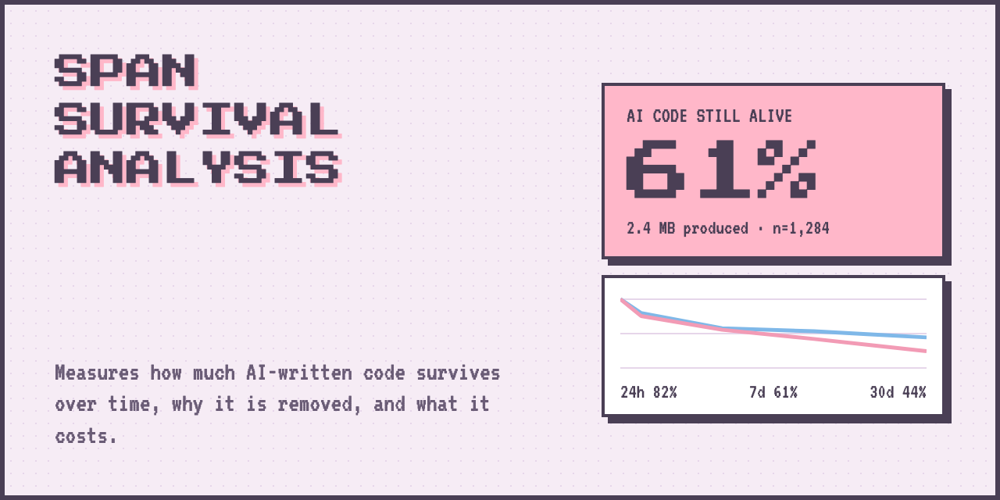

# Span Survival Rate



<sub>Illustration with demo numbers, not real data.</sub>

**How much of the code your AI agent writes is still there a day, a week, a month later, and why the rest disappears.**

This is a fork of [git-ai](https://github.com/git-ai-project/git-ai). It keeps git-ai's attribution engine and adds a measurement on top: span survival rate.

## What is span survival rate?

- A **span** is one stretch of bytes an AI agent wrote in one edit.
- **Span survival rate** is the share of those bytes that are still in your code after a set time: 24 hours, 7 days or 30 days.
- Each span also remembers the call that produced it: the model, the effort level, how long it thought, and whether the cache was used. It also remembers what it replaced: your code, earlier AI code, or nothing.

That lets you ask more than "how much AI code do I have?". You can ask *which AI code lasts, and what made it last*.

Survival is measured in **bytes**, not tokens, so read every number as "share of bytes".

## Install

Requirements: macOS on Apple Silicon, and [Claude Code](https://claude.com/claude-code). Claude Code is the only agent whose transcripts are read today, so spans from other agents show up as `unknown`.

```bash
curl -fsSL https://github.com/thubpham/git-ai/releases/download/v0.1.0-span-survival-rate-rc1/install.sh | bash
```

The script installs the binary to `~/.git-ai/bin` and sets up the Claude Code hooks.

Then:

1. Open a new terminal so `git-ai` is on your `PATH`.
2. Use Claude Code and commit as you normally would. There is no per-repo setup.
3. Wait. Data builds up as you work, and a span only counts toward a horizon once it is that old. On day one you will see the 24h row start to fill in the evening. 7d needs a week of use, and 30d needs a month.

To try the report right away with made-up numbers:

```bash
git-ai survival --demo
```

**Notes**
- The build is unsigned and not notarized. Installing through the `curl` script avoids macOS quarantine. If you downloaded the binary in a browser, run `xattr -d com.apple.quarantine git-ai` on it.
- Auto-update is off in this fork. **Do not run `git-ai upgrade`**: it would install the upstream build over this one.

## Viewing the results

Run the report in your terminal:

```bash
git-ai survival
```

Options:

| Flag | What it does |
|---|---|
| `--age 24h\|7d\|30d` | Pick the age used by the slices, files and cost sections. Default: the longest age that has data. |
| `--from commit\|generation` | Pick where the clock starts. See [The two clocks](#the-two-clocks). Default: `commit`. |
| `--json` | Print the whole report as JSON instead of text. |
| `--no-measure` | Skip taking fresh measurements; show what is already stored. |
| `--demo` | Show made-up data, safe to share. |

The report is private to your machine. Real file paths appear in the best and worst files section, so use `--demo` for anything you share.

## What the report shows

The report has six sections. This is the order they appear in.

### 01 How much survives
The headline. Bytes AI wrote, how many are still there, and the retention rate at 24h, 7d and 30d, once for each clock. A row only counts spans that are at least that old, so the 30d row is empty for the first month.

### 02 Survival curve
The same numbers as bars, from 100% at the start down through each age. Easy to see how fast code falls away.

### 03 Why it dies
Of the bytes that disappeared:
- **who removed them:** AI, a known human edit, or untracked (a change we did not see being made).
- **how:** replaced by new text, or deleted outright.

### 04 Slices
Retention at the chosen age, split by how the code was written. Bars are weighted by bytes, so big edits count more. Groups with fewer than 10 spans are marked too few.
- **What it replaced:** human code, AI code, or a fresh addition. This is the relationship view: AI over AI, AI over human.
- **Edit type:** added or replaced.
- **Tool:** a file edit tool or a Bash command.
- **Model and effort:** which model at which effort level.

### 05 Best and worst files
The files whose AI code lasted longest and shortest. Files with under 1 KB of AI code are left out.

### 06 Cost per surviving KB
Dollars spent on each model's calls for every kilobyte of its code that survived. This uses dollars, not token counts, because raw token totals are dominated by cache reads.

## How to read it

### The two clocks
- **from commit:** the clock starts when the code is first committed. Code that was never committed is not counted. This answers "of what I kept, how much lasted?"
- **from generation:** the clock starts when the AI wrote it, and includes code that was never committed. This answers "of everything the AI wrote, how much lasted?"

Both are shown side by side. Neither is the final headline yet.

### What counts as "survived"
Every later edit moves or removes the bytes of earlier spans. A span's survival is its original size minus the bytes later edits removed, up to the age in question. Moves are not detected: moving code counts as the old bytes being lost. If an AI does the move, the new copy is counted as a new span.

## Known limitations

- **Human edits are undercounted.** A human edit is only seen when the editor extension fires a known-human checkpoint. Without it, human edits land in "untracked" or "unknown".
- **Bytes, not tokens.** The name says tokens in places; the number is bytes.
- **Claude Code only.** Spans from other agents have no call data and show as `unknown`.
- **Young data.** The 30-day horizon has nothing until you have used it for 30 days.
- **Renames.** A renamed file loses its spans (they go `unknown`).
- **Partial staging is approximated.** Every span in a committed file is treated as committed.
- **A file deleted outside a checkpoint** overstates survival.
- **macOS Apple Silicon only.** No Windows or Linux build, and the build is unsigned.

## Where the data lives

Facts are kept in a local SQLite file, `transcript-facts-db`, in the git-ai internal directory (`~/.git-ai/internal`). `git-ai survival` only reads this file. It is never pruned.

## Credits

Built on [git-ai](https://github.com/git-ai-project/git-ai), an open source git extension for tracking AI-written code. The upstream project's docs and license apply to everything not specific to span survival.
